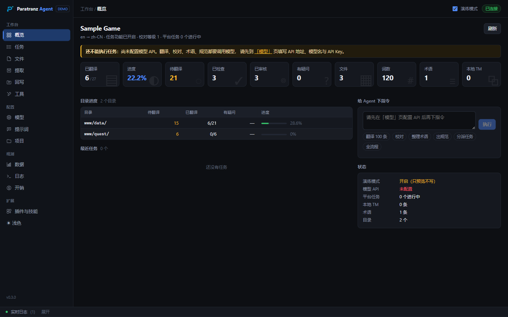
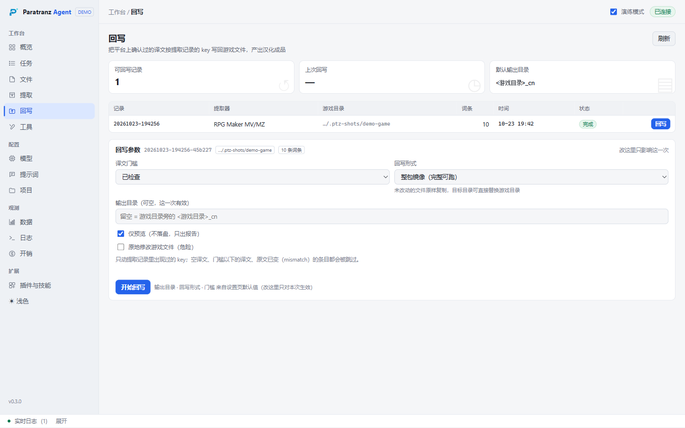
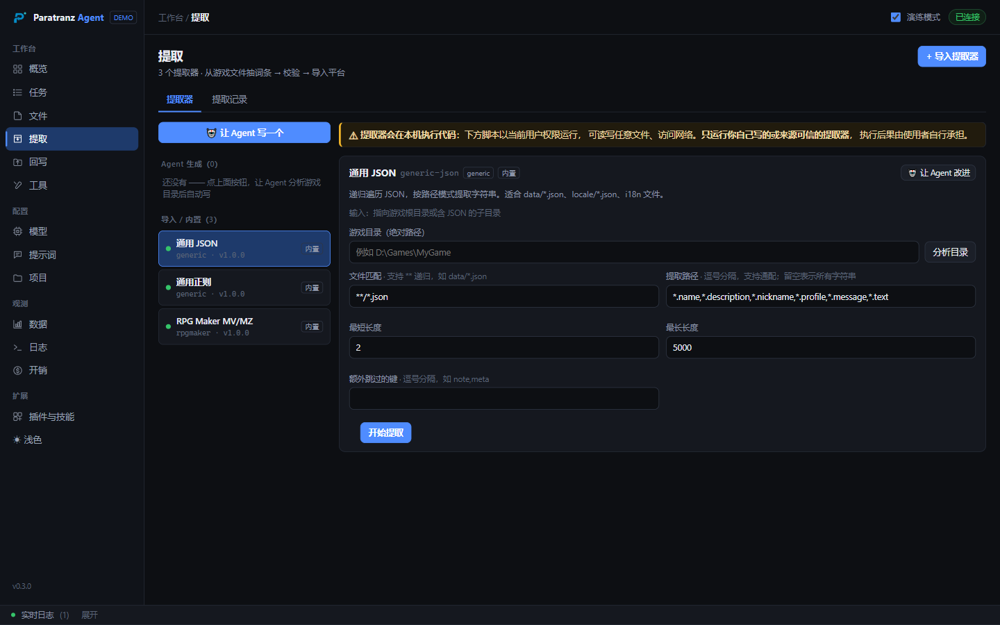
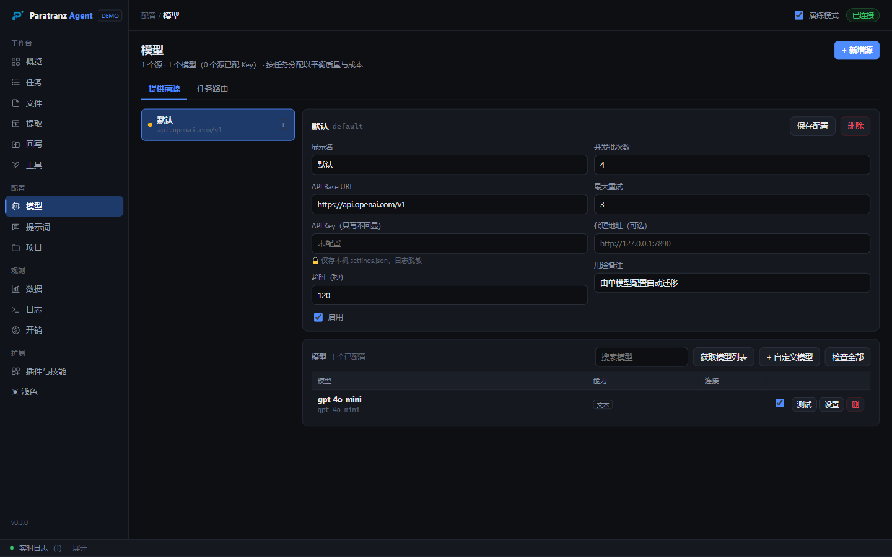
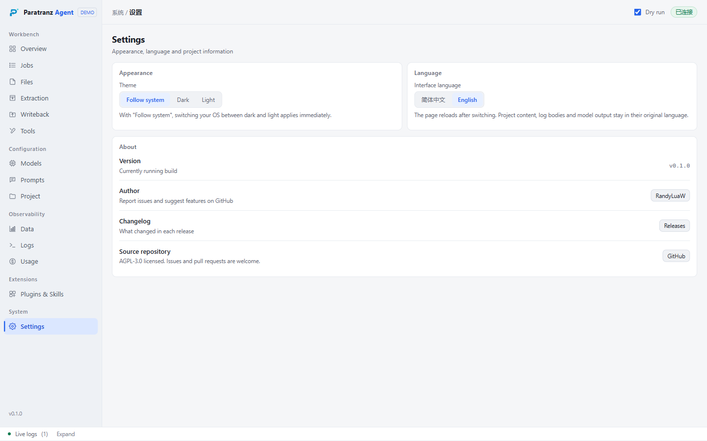

<div align="center">


# Paratranz Agent

**面向 ParaTranz 汉化项目的全流程 Agent 工具：分派、翻译、校对、术语、规范，以及「游戏文件 ↔ 平台」的双向链路。**

[](https://github.com/RandyLuaW/Paratranz-Agent/actions/workflows/ci.yml)
[](https://github.com/RandyLuaW/Paratranz-Agent/releases/latest)
[](LICENSE)
[](https://www.python.org/downloads/)
[](https://github.com/RandyLuaW/Paratranz-Agent/releases/latest)

简体中文 ｜ [English](README.en.md) ｜ [WebUI 说明](WebUI说明.md) ｜ [**下载 Windows 免安装包**](https://github.com/RandyLuaW/Paratranz-Agent/releases/latest)

</div>

---

## ✨ 项目定位

汉化项目的主要成本并不在于单条译文的翻译，而在于随之而来的流程性工作：将数千条词条切分为任务、跟踪进度、逐条校对格式、维护术语表、撰写规范公告，最终再把译文逐条写回游戏文件。

**Paratranz Agent** 将上述流程交由 Agent 执行。本工具并非批量上传工具，而是一套**平台侧全流程自动化与本地文件双向同步**工具：以单条命令启动可视化控制台，可在界面中填写 Token、点击操作，或直接以自然语言下达指令。

- **唯一硬依赖**为 ParaTranz OpenAPI，不依赖任何第三方 SDK 或 MCP
- **前端零构建**：安装后即可运行，无需 Node 环境
- **不模拟模型**：未配置 API 时直接报错，不提供「看似运行、实则未翻译」的降级表现
- **凭据仅存本机**：Token 与 API Key 只写入本地 `settings.json`，日志与错误信息统一脱敏

---

## 🚀 功能

### 五条流水线（可通过 `ptz` 命令行或界面触发）

| 流水线 | 职责 | 实现要点 |
| --- | --- | --- |
| **分派** `plan` | 按目录分片、按未翻译量装箱，生成带验收标准的任务说明 | 以目录为分片单位；去重键不含可变计数，重复执行不产生重复任务 |
| **翻译** `translate` | 翻译记忆精确命中时直接复用，其余分批提交模型（附术语表、TM 参考与风格要求） | 占位符不一致的条目在本地即拦截，不写回平台 |
| **校对** `review` | 先执行 9 类确定性 QA 规则，`error` 级直接打回，其余交由 LLM 二审 | 判定采用 **fail-closed** 策略：模型未明确判定为通过时，不视为通过 |
| **术语** `glossary` | 由模型从「原文 / 已定稿译文」句对中抽取术语，并以词频统计补充，批量导入 | 发布前先获取平台术语表，获取失败则放弃发布，避免覆盖人工维护的术语 |
| **规范** `styleguide` | 依据项目实际文件构成、进度、术语表与 QA 规则集生成 Markdown，并发布为公告 | 存在同标题公告时执行更新而非新建 |

### 双向链路：游戏文件 ⇄ 平台

这是本工具区别于平台客户端的关键：**提取**与**回写**共用同一套定位符。

```
游戏文件 ──提取器──▶ JSONL 词条 ──导入──▶ 平台 ──翻译/校对──▶ 确认译文
   ▲                                                              │
   └──────────────── 回写（按 key 回原位替换）◀──────────────────┘
```

- **提取（Extraction）**：采用可插拔提取器协议（一个目录对应 `extractor.yaml` 与入口脚本，输出 JSONL）。内置通用 JSON、通用正则、RPG Maker MV·MZ 三种；亦支持由 Agent 读取游戏目录、生成提取器并自动试跑。
- **回写（Writeback）**：将平台上**达到门槛**（默认为「已检查」）的确认译文写回游戏文件，产出一个可直接运行的汉化版目录。

**关键设计：key 即定位符。** 提取阶段将「文件相对路径 + 文件内位置」编码进 key（如 `data/Actors.json::[12].name`、`Map001.json::ev3p0[45]`、`cfg/ui.txt::L123#1`），因此回写无需重新解析游戏格式，按 key 回到原位置替换即可。

回写设有**三条安全约束**（宁可不写，也不误写）：

1. **原文校验**：文件中当前文本必须与平台记录的原文一致，否则跳过并报告「原文不一致」。游戏本体更新后 key 会整体错位，强行写入将损坏数据。
2. **默认不原地修改**：产出至独立目录。默认采用**整包镜像**：未改动的文件原样复制，已改动的文件直接写入改写版本，目标目录可直接替换游戏目录；亦可仅输出被改动的文件。
3. **原地修改需显式授权并自动备份**：需通过 5 秒倒计时确认与后端 `accept_risk` 强制校验；备份写入状态目录（不放入游戏目录，否则下次提取会把备份当作源文件重复扫描），并生成 manifest。

### 模型与成本

- **多 provider 管理**：单个源可挂载多个模型（适用于中转站、聚合网关等场景），每个模型可独立配置参数，支持一键探测可用模型、逐模型检测连通性与延迟。
- **按任务分配模型**：翻译、校对、术语、规范、Agent、提取器生成各自路由至不同模型，低复杂度任务可分配小参数量模型。
- **成本控制**：逐次调用记账，并提供四维预算（单次 / 单任务 / 每日 / 每月），超限时可选择仅告警或直接阻断。

### 其他

- **深色 / 浅色主题**：跟随系统或手动切换，两套配色均按对比度标准取值
- **可观测性**：实时日志（SSE）、任务队列、用量与花费统计、数据页（词条 / TM / 术语 / 账本）
- **扩展位**：插件 / SKILL / MCP 三栏管理（预留接口）
- **提示词可配置**：六个环节的 system prompt 均可在界面中替换，留空则使用内置默认值
- **设置页**：外观（跟随系统 / 深色 / 浅色）、界面语言（简体中文 / English）与关于信息集中在一处

---

## 🖥 界面预览

<table>
<tr>
<td width="50%"><br/><sub><b>概览</b>：单屏汇总进度、目录分布、最近任务与运行状态</sub></td>
<td width="50%"><br/><sub><b>回写</b>（浅色主题）：选择记录 → 设定门槛与产出形态 → 生成报告</sub></td>
</tr>
<tr>
<td><br/><sub><b>提取</b>：提取器管理、风险提示与提取记录</sub></td>
<td><br/><sub><b>模型</b>：源 → 模型 → 任务路由，三层结构</sub></td>
</tr>
<tr>
<td colspan="2"><br/><sub><b>设置</b>（English · 浅色主题）：外观三态、界面语言与关于信息</sub></td>
</tr>
</table>

> 截图取自 `ptz serve --mock`（内置假平台演示模式，不访问真实项目）。

---

## 🏁 快速开始

### 方式一：Windows 免安装包（无需编程环境）

在 [**Releases**](https://github.com/RandyLuaW/Paratranz-Agent/releases/latest) 下载
`paratranz-agent-x.y.z-win64.zip`，解压至任意目录（路径可含中文与空格），随后：

| 文件 | 作用 |
| --- | --- |
| **`web.bat`** | 启动可视化控制台，浏览器自动打开 `http://127.0.0.1:8787` |
| **`ptz.bat`** | 命令行入口（等价于 `ptz`，参数原样传递，如 `ptz.bat status`） |

**无需安装 Python，也无需联网安装依赖**：压缩包内已附带官方 Python 运行时与全部依赖，约 20 MB。

- 如需先预览界面：`web.bat --mock`（内置假平台，完整演示五条流水线，不访问真实项目）
- 数据保存在解压目录下的 `.ptz-state\` 中（Token、Key、任务与提取记录）；备份时复制该目录即可，迁移机器时一并带走
- 卸载方式：删除该目录即可，不写入注册表、不安装系统服务
- 包内附带 `快速上手.txt`，涵盖首次配置、常见问题与卸载说明

### 方式二：从源码安装

```bash
git clone https://github.com/RandyLuaW/Paratranz-Agent.git
cd paratranz-agent
python -m venv .venv
# Windows: .venv\Scripts\activate      Linux/macOS: source .venv/bin/activate
pip install -e .
```

需要 Python 3.11 及以上版本。随后执行：

```bash
ptz serve            # 打开 http://127.0.0.1:8787
ptz serve --mock     # 无需 Token 的演示模式
```

Windows 环境下也可直接双击仓库中的 `web.bat`。

### 配置项目与模型

全部配置均在界面中完成，无需修改文件：

1. **「项目」页**：填写 ParaTranz API Token 与项目编号，点击「测试连接」
2. **「模型」页**：配置一个 OpenAI 兼容 API（地址、Key、模型名），可点击「获取模型列表」自动探测

完成上述配置后，可在「概览」页直接下达指令，或在各功能页执行操作。

### 常用命令

```bash
ptz doctor                       # 体检：Token、权限、平台能力开关
ptz status                       # 项目进度概览
ptz plan --dry-run               # 预演分派，不写入平台
ptz translate --limit 200 --yes  # 实际翻译 200 条
ptz review --yes                 # 校对并写回 stage
ptz glossary --yes               # 抽取术语并发布
ptz styleguide --yes             # 生成规范并发布为公告
ptz writeback <提取记录id> --yes  # 将确认译文写回游戏文件
ptz watch                        # 常驻守护：有任务即执行，无任务则等待
```

写操作默认以 **dry-run** 执行，需显式指定 `--yes` 才会实际写入；所有命令均支持 `--json`，便于上层编排。

---

## 🔐 安全设计

本工具会**在用户机器上执行代码**（提取器）、**改动游戏文件**（回写）、**产生模型调用费用**（翻译）。因此采取以下措施：

| 风险 | 处置 |
| --- | --- |
| 提取器等同于本机任意代码执行 | 常驻警示条、5 秒倒计时确认与后端 `accept_risk` 强制校验；校验位于**工具层**，因此路由、`POST /api/jobs` 与 `/api/agent` 三个入口均无法绕过 |
| Agent 被提示注入触发危险动作 | `/api/agent` 不自动执行危险工具，仅列出待确认步骤，由用户手动确认后执行 |
| 回写覆盖游戏文件 | 默认产出至独立目录；原地修改需显式授权，并自动备份且生成 manifest |
| 凭据泄露 | 仅保存在本地 `settings.json`（收紧文件权限）；接口仅回显尾号；日志、SSE 与错误响应统一脱敏 |
| 任意网页调用本机 WebUI | 校验 `Host` 与 `Origin`，防御 DNS rebinding 与 CSRF |
| 误连真实项目 | 演示模式与真实模式在界面中明确区分（`DEMO` 标记） |

---

## 📚 文档

| 文档 | 内容 |
| --- | --- |
| [WebUI 说明](WebUI说明.md) | 各页面使用方法、两个安全开关、API 一览 |
| [English README](README.en.md) | 英文版说明 |
| [CHANGELOG](CHANGELOG.md) | 各版本改动 |
| [config/agent.example.yaml](config/agent.example.yaml) | 配置文件模板（亦可在界面中完成配置） |
| `ptz --help` / 各子命令 `--help` | 命令行用法（写操作默认 dry-run，需 `--yes`） |

---

## 🛠 开发

```bash
pip install -e ".[dev]"
python -m pytest tests -q      # 单元测试与端到端测试（全部离线，使用内存假平台）
python smoke.py                # CLI 全流程冒烟
python web_smoke.py            # WebUI 冒烟（真实 HTTP 请求）
python -m ruff check --select F,E9,B,S102,S301,S307,S506,S608,ASYNC src tests smoke.py web_smoke.py tools
```

CI 在 ubuntu 与 windows 上分别执行 Python 3.11 / 3.13 两版。仓库另附若干真机验证工具（需自备 Token，请谨慎使用）：

- `tools/build_portable.py`：构建 Windows 免安装包（下载官方 embeddable Python、打包 zip 并生成自检与 sha256），发版时一条命令完成
- `tools/realcheck.py`：真实平台体检，涵盖端点返回形态、QA 规则分布、抽样复核与 stage 复位
- `tools/verify_writeback_real.py`：回写全链路真机验证（自建临时文件，执行后自动清理）
- `tools/check_spec_coverage.py`：以 AST 比对 `client.py` 与官方 OpenAPI spec，检查端点与参数名错误

---

## ⚖️ 免责与免费声明

### 责任范围

本项目为**第三方工具**，与 ParaTranz 官方无关。本工具会以用户身份调用 ParaTranz API，请自行确认项目权限与平台条款。

危险动作（执行提取器脚本、原地改写游戏文件、对真实项目发起写请求）均需用户显式确认，**后果由使用者自行承担**。建议先在 `--mock` 演示模式或闲置项目上完成验证，再用于正式项目。

### 本软件完全免费

本软件**完全免费**，不以任何形式收费。唯一官方发布渠道为本仓库：<https://github.com/RandyLuaW/Paratranz-Agent>。

若通过任何付费渠道（付费下载站、资源包售卖、代安装服务、"会员专享"合集等）取得本软件，请立即申请退款，并从上方的 Releases 页面免费获取软件本体。官方仓库不会收取任何费用，也不存在需要购买的"激活码""授权码"或"内部版本"。

软件首次启动时会在控制台显示同一份声明（中英双语），设置页「关于」中另保留入口。完整文本见 [`NOTICE.txt`](NOTICE.txt)，免安装包内另附 `免费声明.txt`。

---

## 📄 License

本项目采用[自定义源码许可](LICENSE)（源码公开，非 OSI 认证的开源许可），完整条款以 `LICENSE` 中的英文正文为准。

可自由使用、修改与免费分发；分发须署名原作者并附官方仓库链接；作为网络服务提供时禁止任何形式收费。

具体地：

- **允许**：以任何目的使用；研究与修改源代码；发布新的分叉与衍生作品；以源码或二进制形式**免费**分发。
- **分发时必须**：标注原作者（RandyLuaW）；包含官方仓库原始链接 <https://github.com/RandyLuaW/Paratranz-Agent>；说明这是修改版（若确有修改）；保留 `LICENSE`、版权声明与 `NOTICE.txt`。
- **禁止**：就本软件或其修改版本收费（含销售、付费分发）；将其作为网络服务对外提供时收取任何形式的费用（订阅、一次性付费、积分制、「付费后访问」等）；以不同条款再许可。
- **保留**：上述未明确授予的一切权利由作者保留。
- **商业授权**：如确需以本许可不允许的方式使用（例如就网络服务收费、或闭源集成），可向作者申请单独的书面授权；取得授权前，全部限制照常适用。许可另含贡献者的专利授权，以及违约后 30 日内的改正补救期。

第三方依赖遵循各自许可，清单见 [`THIRD-PARTY-LICENSES.txt`](THIRD-PARTY-LICENSES.txt)。如需其它授权方式（例如商业闭源集成），欢迎提交 issue 讨论。
